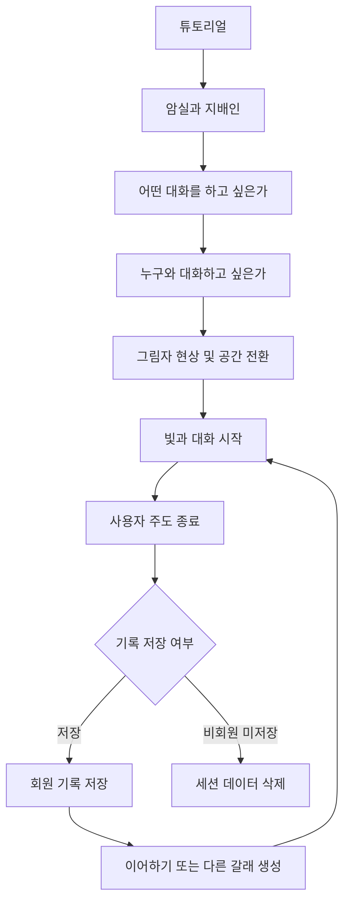
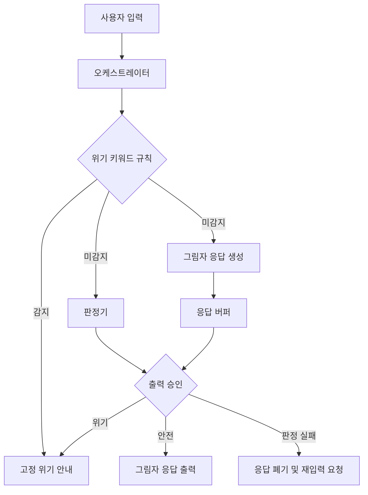

# 그림자 대화 | Shadow Talk

> 선택하지 않았거나 아직 오지 않은 가능성과 대화하는 공간.

## 프로젝트 소개

**그림자 대화**는 암실에서 AI가 현상한 그림자와 대화를 나누는 인터랙티브 내러티브 대화 경험입니다. 그림자는 실제 인물의 복제가 아닌 하나의 가능성입니다.

실제로 사용할 수 있는 **비상업적 AI 개발 포트폴리오**를 목표로 합니다. 게임의 승패, 상담·코칭, 수익화, 재방문율 및 체류 시간 증대는 목표에 포함하지 않습니다.

- 기준 문서: 그림자 대화 PRD v0.7 (2026-11-16)
- 현재 문서 기준: 요구사항 설계 단계. 구현 완료 여부 및 성능은 별도 검증 필요.

## 세계관

| 요소 | 설명 |
|---|---|
| 암실 | 대화를 위해 방문하는 공간 |
| 지배인 | 사용자 안내, 그림자 현상 및 마무리를 돕는 존재 |
| 그림자 | 사용자의 열망과 감정에서 비롯된 가능성 속 대화 상대 |
| 빛 | 대화가 흐르는 시간을 표현하는 연출. 실제 자원 한도와 분리 |
| 선명도 | 설정과 대화 맥락의 구체성·일관성을 표현하는 갈래별 4단계 연출 |

## 주요 기능 (구현 예정)

- 가입 없이 첫 대화를 체험하고 저장을 원할 때 가입
- 소개팅, 회사 면접, 가족, 자유 대화의 상황 선택 및 상대 설정
- 그림자 카드 기반의 캐릭터 일관성 유지
- 텍스트 대화 및 버튼식 STT·TTS 음성 대화
- 사용자 주도 종료, 기록 저장·이어하기·삭제
- **다른 가능성 현상(F-18)**: 과거 장면에서 새 갈래를 만들고 원본 보존
- 별도 동의 기반 속마음 채널: 발화와 운율에서 추정한 기분만 전달
- 위기 감지 및 안전한 응답 출력 제어

## 사용자 흐름

## AI 아키텍처

EXAONE 3.5 7.8B 모델 인스턴스 하나를 세 에이전트가 역할별 프롬프트로 공유합니다.

| 에이전트 | 역할 |
|---|---|
| 지배인 | 안내, 현상 인터뷰, 마무리 제안, 위기 시 몰입 해제 |
| 그림자 | 상황과 그림자 카드에 맞는 상대 역할 수행 |
| 판정기 | 위기 등급, 매듭 신호, 반복 고통 신호 분류 |

위 구조는 병렬 실행 기본안입니다. 순차 방식과 병렬 방식은 기술 검증에서 비교하며, 어느 방식이든 판정 전 그림자 응답은 출력하지 않습니다.

### 대화 맥락 및 갈래 관리

- 세계관·상황별 고정 규칙, 그림자 카드, 관계 메모리, 롤링 요약 및 최근 대화 원문 활용
- 분기 이전 메시지는 복사하지 않고 참조하며, 분기 시점 요약은 스냅샷으로 보존
- 원본 메시지 불변, 갈래별 요약 및 선명도 관리
- 참조 카운트 및 DB 트랜잭션 기반 갈래 삭제

### 음성 및 속마음

- Push-to-Talk, STT·TTS, VAD, 화자 확인, 에코 차단
- 별도 동의(옵트인) 후 속마음 채널 활성화
- 발화 내용과 운율을 분석해 기분 라벨과 강도만 그림자에게 전달
- 마이크 끄기 및 수동 기분 선택 지원
- 속마음 전사 원문은 처리 직후 폐기, 기분 정보는 세션 종료 시 삭제

## 기술 구성

| 구분 | 계획 |
|---|---|
| LLM | EXAONE 3.5 7.8B, Q4_K_M 양자화 검토 |
| 모델 서빙 | 단일 모델 인스턴스 공유, 온프레미스 추론 |
| 음성 | 한국어 STT·TTS, VAD, 화자 확인, 운율 분석 |
| 맥락 관리 | 롤링 요약, prefix caching |
| 데이터 모델 | User, Shadow, Branch, Session, Message, Summary, SavePoint, CrisisEvent |
| 운영 환경 | 자택 PC, GPU·VRAM·RAM·CPU 확인 예정 |

프론트엔드·백엔드 프레임워크, DB 제품, 서빙 엔진 및 음성 모델은 최종 확정 전입니다. EXAONE 32B는 헤비 버전 비교 실험 후보이며 필수 사양이 아닙니다.

## 개발 로드맵

| 단계 | 구현 및 검증 범위 |
|---|---|
| 0. 기술 검증 | 자택 PC 사양, LLM 추론, 한국어 품질, 음성 모델, 라이선스, 지연 및 VRAM 측정 |
| 1. 핵심 대화 | 튜토리얼, 지배인, 그림자 현상, 텍스트 대화, 기본 위기 대응 |
| 2. 가능성 분기 | 회원 저장, 이어하기, 새 갈래 생성, 원본 보존 |
| 3. 안전·운영 | 위기 테스트, 기록 삭제, 오류 처리, 접근 통제 |
| 4. 음성·속마음 | STT·TTS, 화자 확인, 에코 차단, 기분 전달 — 라이트 MVP 완성 |
| 5. 고도화 (선택) | 선명도 연출, 지배인 서사, 32B 비교 실험 |

라이트와 헤비는 유료 등급이 아니라 구현 범위와 하드웨어 사양의 차이입니다. 외부 공개는 안전·운영 검증 및 라이선스 확인 이후 결정합니다.

## 품질 및 수용 기준

다음은 PRD의 목표이며 실제 측정 결과가 아닙니다.

| 항목 | 목표 |
|---|---|
| 핵심 플로우 완주율 | 90% 이상 |
| 캐릭터 일관성 루브릭 통과율 | 90% 이상 |
| 종료·저장·삭제 요청 반영 | 100% |
| 원본 및 새 갈래 보존 | 100% |
| 위기 테스트 세트 안내 누락 | 0건 |
| 응답 지연 | 0단계 실측 후 확정 |

상황별 골든 시나리오 40개와 별도의 위기 테스트 문장 200개 이상을 활용할 계획입니다. 테스트 세트에서 누락 0건을 달성하더라도 실제 모든 위기 발화의 탐지를 보장하지는 않습니다.

## 개인정보 보호 및 안전 설계

- 대화 데이터 학습 미사용 및 온프레미스 AI 추론
- 대화 원문·요약·그림자 카드 암호화 및 접근 통제
- 비회원 데이터 정상 종료 시 삭제, 비정상 종료 시 서버 TTL로 정리
- 음성 원본 및 속마음 전사 비저장, 기분 정보 세션 종료 시 삭제
- 위기 판정 전 응답 보류, 위험 감지 시 고정 안내
- 실존 인물 복제, 상담·치료 대체, 점수 및 평가 기능 제외

## 라이선스 및 공개 정책

본 프로젝트는 비상업적 포트폴리오 목적으로 진행합니다. PRD에 명시된 EXAONE 3.5의 모델 라이선스는 **EXAONE AI Model License Agreement 1.1 - NC**입니다.

비상업적 목적이라고 모든 공개·배포가 자동으로 허용되는 것은 아니므로 외부 공개 전 모델 및 의존성의 이용·배포·표시 조건을 확인합니다. 프로젝트 소스 코드 자체의 라이선스는 별도 결정 사항입니다.

- [EXAONE 3.5 7.8B 모델](https://registry.ollama.ai/library/exaone3.5:7.8b)
- [모델 라이선스](https://registry.ollama.ai/library/exaone3.5/blobs/294fd63925d8)
- [기술 보고서](https://arxiv.org/html/2412.04862v3)

## 프로젝트 문서

- 그림자 대화 PRD v0.7 — 기능 요구사항, 수용 기준, AI 설계, 운영 정책 및 개발 순서의 기준 문서

실행 방법과 저장소 구조는 실제 기술 스택 및 구현 확정 이후 추가합니다.
